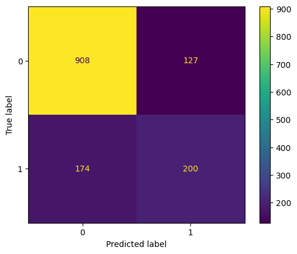

# Telco Customer Churn: Segmentation, Prediction and Retention Strategy

End-to-end analysis of customer churn for a telecom company: data cleaning, exploratory analysis, RFM-style customer segmentation, an XGBoost churn model tuned for recall, explainability, and a retention strategy with an estimate of business impact.

**Tech stack:** Python, pandas, NumPy, scikit-learn, XGBoost, SHAP, matplotlib, seaborn

---

## 1. Business problem

A telecom company loses roughly one in four customers. Keeping an existing customer is usually cheaper than acquiring a new one, so the goal is to:

1. Find which customers are most likely to leave.
2. Understand what drives churn.
3. Group customers into segments the business can act on.
4. Recommend retention actions and estimate what they are worth.

**Success measure:** catch as many real churners as possible (recall) without wasting too many retention offers (precision).

## 2. Dataset

- Source: [Telco Customer Churn on Kaggle](https://www.kaggle.com/datasets/blastchar/telco-customer-churn)
- 7,043 customers, 21 columns (demographics, services, contract, billing, and the target `Churn`)
- About 26% of customers churned, so the classes are imbalanced
- The data file is **not included** in this repo. Download it from Kaggle and place it in `data/` (see "How to run").

## 3. Approach

1. **Data cleaning**
   - `TotalCharges` was stored as text and contained 11 blank values (customers with `tenure = 0`), which a normal null check misses. Converted to numeric and filled with 0.
   - Recoded "No internet service" and "No phone service" to "No" in the add-on columns, since `InternetService` and `PhoneService` already carry that information.
   - Dropped `customerID`, encoded `Churn` as 0/1, treated `SeniorCitizen` as categorical.
2. **Exploratory data analysis:** churn rate by contract, internet service, payment method, tenure, monthly charges and add-on services.
3. **Segmentation (RFM proxies):** the dataset has no transaction dates, so RFM was approximated:

   | RFM idea | Proxy used |
   |---|---|
   | Recency | `tenure` (months with the company) |
   | Frequency | `num_services` (number of services subscribed) |
   | Monetary | `MonthlyCharges` |

   Each proxy was scored 1 to 4 by quartile, combined into an RFM score, and grouped into Low / Mid / High value segments.
4. **Modeling:** XGBoost classifier (`n_estimators=300`, `max_depth=7`, `learning_rate=0.05`, `random_state=42`), with categorical columns handled natively (`enable_categorical=True`) instead of one-hot encoding. No class weighting or resampling was applied, so the model was trained on the original ~26% churn rate and evaluated at the default 0.5 threshold.
5. **Evaluation:** accuracy, recall, precision, ROC-AUC and PR-AUC on a held-out test set, plus stratified 5-fold cross-validation. Evaluated at the default 0.5 decision threshold; tuning the threshold for higher recall is listed under future work.
6. **Explainability:** XGBoost feature importance [and SHAP values].
7. **Business impact:** simplified customer lifetime value (CLV), revenue at risk, targeting analysis, and a decision table (retention offer / low-cost outreach / early access / leave alone).

## 4. Results

| Metric | Value |
|---|---|
| Baseline accuracy (predict nobody churns) | 73.5% |
| Accuracy | 78.6% |
| Recall (churn class) | 53.5% |
| Precision (churn class) | 61.2% |
| ROC-AUC | 0.830 |
| PR-AUC | 0.638 |
| Decision threshold | 0.50 (default) |

Cross-validated ROC-AUC (stratified 5-fold): 0.830 ± 0.012





## 5. Customer segments

| Segment | Customers | Churn rate | Avg tenure | Avg services | Avg monthly charges | Description |
|---|---|---|---|---|---|---|
| Low value | 1,895 | 26% | 13.2 months | 1.2 | 32.32 | New customers with few services and low spend |
| Mid value | 2,508 | 32% | 27.3 months | 2.8 | 61.40 | Mid-tenure customers with moderate services and spend; highest churn of the three |
| High value | 2,640 | 22% | 50.9 months | 5.5 | 91.24 | Long-tenure customers with many services and the highest spend; lowest churn |

Churn varies only from 22% to 32% across the segments (26.5% overall), so these RFM-proxy segments separate churn only moderately. A likely reason is that longer tenure goes with lower churn while higher monthly charges go with higher churn, so the combined score partly cancels out. The segments are more useful for describing customer value than for predicting churn; the model ranks churn risk much better (see section 8).

## 6. What drives churn

- **Contract type:** month-to-month customers churn at 42.7%, versus 11.3% on one-year and 2.8% on two-year contracts
- **Tenure:** churn falls steadily as tenure grows: 47.4% in the first 12 months, 28.7% in months 13 to 24, 20.4% in months 25 to 48, 14.4% in months 49 to 60, and 6.6% beyond 60. The median churner had a tenure of 10 months, compared with 38 months for customers who stayed.
- **Internet service, payment and add-ons:** fiber optic customers churn at 41.9% (DSL 19.0%, no internet 7.4%). Electronic check payers churn at 45.3%, versus 15% to 19% for other payment methods. Customers without tech support churn at 31.2% (15.2% with it), and those without online security at 31.3% (14.6% with it).
- 88.6% of all churners are on month-to-month contracts.

These are associations found in the data, not proven causes.

## 7. Recommendations

| Finding | Recommended action |
|---|---|
| Month-to-month customers churn at 42.7% vs 2.8% on two-year contracts | Offer a discount or perk for moving to a one- or two-year contract |
| Electronic check payers churn at 45.3%, versus 15% to 19% for other payment methods | Offer a small bill credit for switching to automatic payment |
| First-year customers churn at 47.4% | Run onboarding check-ins at months 1, 3 and 6 |

## 8. Business impact

Assumptions (adjust these to see how the result changes): contact the riskiest 20% of customers in the test set and assume 30% of contacted churners are retained. Figures are gross, before offer costs.

- Contacting the top 20% by predicted risk captures **47.9%** of all churners (about 2.4x better than contacting customers at random).
- Estimated annual revenue retained: **50,487** (dataset currency units, test set only)

### Customer lifetime value (simplified)

- Historical value = `TotalCharges` (what the customer has already paid)
- Future value (12 months) = `MonthlyCharges × 12`
- CLV = historical value + future value
- Revenue at risk = future value × predicted churn probability (out-of-fold)

This is a simplified CLV. The dataset has no purchase history, so probabilistic CLV models (BG/NBD + Gamma-Gamma) could not be used.

### Who gets what (retention priority matrix)

Risk = riskiest 25% by predicted churn probability. Value = CLV above the median.

| Group | Rule | Action | Customers | Actual churn rate | Avg CLV | Revenue at risk |
|---|---|---|---|---|---|---|
| Retention offer | High risk, high value | Personalised offer, contract upgrade | 615 | 52.0% | 3,940 | 441,149 |
| Low-cost outreach | High risk, low value | Automated, low-cost contact (or none if cost > value) | 1,146 | 64.0% | 1,117 | 681,983 |
| Early access / VIP | Low risk, high value | Early access to new features, loyalty perks | 2,907 | 15.1% | 5,284 | 360,429 |
| Leave alone | Low risk, low value | No action | 2,375 | 15.9% | 1,038 | 157,221 |

A churn model shows who is likely to leave, not who will respond to an offer, so "will churn no matter what" customers cannot be identified from this model alone. That needs the experiment below.

## 9. Proposed experiment

A churn model predicts who will leave, not who will respond to an offer. To measure whether an offer works, randomise the high-risk group into treatment and control and compare churn over a fixed period. Sample size from a power analysis (5% significance, 80% power, detecting a drop from 40% to 34%): about **1,000 customers per group**. Results should be analysed by segment (for example new vs loyal customers).


## 10. Repository structure

```
telco-churn-prediction/
├── README.md
├── requirements.txt
├── .gitignore
├── notebooks/
│   └── telco_churn_analysis.ipynb
├── images/              # charts used in this README
├── data/                # place the Kaggle CSV here (not tracked)
├── models/              # optional: saved pipeline (churn_pipeline.joblib)
└── app/                 # optional: Streamlit app
```

## 11. How to run

```bash
git clone https://github.com/AzizurDRahaman/telco-churn-prediction.git
cd telco-churn-prediction
python -m venv .venv
source .venv/bin/activate          # Windows: .venv\Scripts\activate
pip install -r requirements.txt
```

1. Download the dataset from [Kaggle](https://www.kaggle.com/datasets/blastchar/telco-customer-churn) and save it as `data/WA_Fn-UseC_-Telco-Customer-Churn.csv`.
2. Open `notebooks/telco_churn_analysis.ipynb` and run all cells (update the CSV path in the first cells if needed).

## 12. Limitations

- The dataset is a single snapshot with no dates, so true recency could not be computed and a time-based train/test split was not possible. RFM scores are proxies.
- At the default 0.5 threshold the model catches 53.5% of churners, so it misses almost half of them. Threshold tuning and class weighting are the next improvement.
- The business-impact figures rely on assumed retention success rates and offer costs.
- CLV is simplified (historical charges plus 12 months of current charges). Historical spend grows with tenure, so it favours long-standing customers, and it ignores margin and discounting.
- Churn probability does not tell us who will respond to an offer. That needs an experiment or uplift modelling.
- The data comes from one company and may not generalise to other markets.

## 13. Future work

- Use time-stamped data to build features from an earlier window and labels from a later one
- Customer lifetime value models and survival analysis (when will a customer churn)
- Uplift modelling to find customers who respond to offers
- Tune the decision threshold and class weighting to raise recall on churners
- Run the proposed A/B test
- Deploy the pipeline as an API or Streamlit app, with drift monitoring

## 14. Author

Azizur Rahaman · [LinkedIn](https://www.linkedin.com/in/azizur-rahaman-338855202/) - [Github](https://github.com/AzizurDRahaman)
